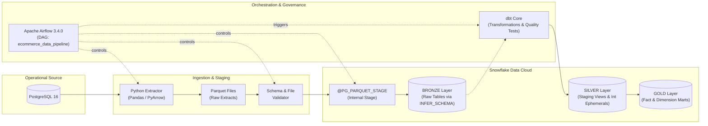

# 🛒 E-Commerce Modern Data Platform

[](https://www.python.org/)
[](https://www.postgresql.org/)
[](https://www.snowflake.com/)
[](https://www.getdbt.com/)
[](https://airflow.apache.org/)
[](https://www.docker.com/)

An end-to-end modern data engineering platform designed to extract transactional data from an operational PostgreSQL database, stage raw records in columnar Parquet format, ingest into Snowflake using Medallion Architecture (Bronze &rarr; Silver &rarr; Gold), transform and test models with **dbt**, and orchestrate the entire ELT workflow via **Apache Airflow** running in Docker.

---

## 📑 Table of Contents

- [Architecture Overview](#-architecture-overview)
- [Data Modeling & Medallion Design](#-data-modeling--medallion-design)
  - [Bronze Layer (Raw Ingestion)](#bronze-layer-raw-ingestion)
  - [Silver Layer (Cleaned & Enriched)](#silver-layer-cleaned--enriched)
  - [Gold Layer (Business Star Schema)](#gold-layer-business-star-schema)
- [Tech Stack](#-tech-stack)
- [Project Structure](#-project-structure)
- [Prerequisites](#-prerequisites)
- [Getting Started](#-getting-started)
  - [1. Clone Repository](#1-clone-repository)
  - [2. Configure Environment Variables](#2-configure-environment-variables)
  - [3. Start Docker Services](#3-start-docker-services)
  - [4. Access Airflow UI](#4-access-airflow-ui)
- [Pipeline Workflow](#-pipeline-workflow)
- [Data Quality & Testing](#-data-quality--testing)
- [Running Components Locally](#-running-components-locally)
- [License & Author](#-license--author)

---

## 🏗 Architecture Overview



1. **Extraction:** An operational PostgreSQL database initializes schemas and seed transactions (customers, orders, products, warehouses, suppliers, order items, inventory). Python extracts tables into timestamped, columnar Parquet files.
2. **Validation:** Checks verify file presence, non-zero file sizes, row counts, and schema readability before staging.
3. **Snowflake Ingestion (Bronze):** Local Parquet files are uploaded into an internal Snowflake stage (`@PG_PARQUET_STAGE`). Tables are dynamically generated via `INFER_SCHEMA` and populated using `COPY INTO`.
4. **dbt Transformation (Silver & Gold):** Staging views normalize column names and datatypes. Intermediate models join and aggregate business metrics. Gold dimensional models build an analytical Star Schema with surrogate keys.
5. **Orchestration:** Apache Airflow DAG (`ecommerce_data_pipeline`) coordinates each stage daily at `02:00 UTC` with automated retries and failure alerting.

---

## 💎 Data Modeling & Medallion Design

The platform applies the **Medallion Architecture** inside Snowflake (`ECOMMERCE_DB`):

```
+-------------------------------------------------------------------------------+
|                               ECOMMERCE_DB                                    |
|                                                                               |
|  +--------------------+    +--------------------+    +---------------------+  |
|  |    BRONZE SCHEMA   |    |    SILVER SCHEMA   |    |     GOLD SCHEMA     |  |
|  |    (Raw Tables)    |    | (Views & Ephemeral)|    |    (Marts Tables)   |  |
|  |                    |    |                    |    |                     |  |
|  | - CUSTOMERS        |    | - stg_customers    |    | - dim_customers     |  |
|  | - SUPPLIERS        |    | - stg_suppliers    |    | - dim_products      |  |
|  | - WAREHOUSES       |    | - stg_warehouses   |    | - dim_warehouses    |  |
|  | - PRODUCTS         |    | - stg_products     |    | - fct_orders        |  |
|  | - ORDERS           |    | - stg_orders       |    | - fct_inventory     |  |
|  | - ORDER_ITEMS      |    | - stg_order_items  |    +---------------------+  |
|  | - INVENTORY        |    | - stg_inventory    |                             |
|  +--------------------+    | - int_orders_enr.  |                             |
|                            | - int_items_enr.   |                             |
|                            +--------------------+                             |
+-------------------------------------------------------------------------------+
```

### Bronze Layer (Raw Ingestion)
- Loaded directly from Parquet files without transformation.
- Schema auto-detection using Snowflake `INFER_SCHEMA` ensures backward compatibility.
- Tables: `CUSTOMERS`, `SUPPLIERS`, `WAREHOUSES`, `PRODUCTS`, `ORDERS`, `ORDER_ITEMS`, `INVENTORY`.

### Silver Layer (Cleaned & Enriched)
- **Staging Views (`stg_*`):** Typecasting, column renaming to standard snake_case, null handling, and source verification.
- **Intermediate Models (`int_*`):** Ephemeral models enriching order lines (`int_order_items_enriched`) with product margins and category details, and aggregating order summaries (`int_orders_enriched`) with line counts and totals.

### Gold Layer (Business Star Schema)
Materialized as physical tables optimized for BI tools and downstream analytics:
- **`dim_customers`**: MD5 surrogate key (`customer_key`), customer demographics, contact information, and registration timestamps.
- **`dim_products`**: MD5 surrogate key (`product_key`), product catalogue, category hierarchy, unit pricing, and supplier associations.
- **`dim_warehouses`**: MD5 surrogate key (`warehouse_key`), geographical warehouse locations and facility codes.
- **`fct_orders`**: Grain of one row per order, joined with customer surrogate keys, total order value, item quantities, status tracking, and delivery timelines.
- **`fct_inventory`**: Grain of one row per warehouse inventory item, linked to product and warehouse dimension keys with available quantity and total inventory valuation.

---

## 🛠 Tech Stack

| Technology | Purpose |
| :--- | :--- |
| **Python 3.12** | Core programming language for ingestion scripts and database drivers |
| **PostgreSQL 16** | Operational relational database (OLTP) with automated initialization |
| **Snowflake** | Cloud Data Warehouse housing Bronze, Silver, and Gold Medallion layers |
| **Apache Airflow 3.4.0** | Orchestration engine scheduling DAG execution and task dependencies |
| **dbt Core (dbt-snowflake)** | SQL transformation framework, schema testing, and documentation |
| **PyArrow / Pandas** | Columnar Parquet serialization, extraction handling, and local verification |
| **Docker & Docker Compose** | Multi-container deployment (Airflow Scheduler, Webserver, PostgreSQL DBs) |

---

## 📁 Project Structure

```plaintext
ecommerce-data-platform/
├── airflow/
│   ├── dags/
│   │   └── ecommerce_data_pipeline.py  # Airflow DAG defining ELT pipeline
│   ├── dbt_profiles/
│   │   └── profiles.yml                # Snowflake dbt profile (env var driven)
│   ├── Dockerfile                      # Custom Airflow image with dbt & drivers
│   └── requirements.txt                # Airflow container Python packages
├── data/
│   ├── generated/                      # Generated / scratch data (.gitkeep)
│   └── raw/
│       └── postgres/                   # Local raw Parquet extractions (.gitkeep)
├── dbt/
│   └── ecommerce_analytics/
│       ├── dbt_project.yml            # dbt configuration & model schema paths
│       ├── macros/
│       │   └── generate_schema_name.sql # Custom schema naming (SILVER/GOLD)
│       └── models/
│           ├── intermediate/           # Ephemeral enrichment models
│           │   ├── int_order_items_enriched.sql
│           │   └── int_orders_enriched.sql
│           ├── marts/                  # Gold dimension and fact tables
│           │   ├── dim_customers.sql
│           │   ├── dim_products.sql
│           │   ├── dim_warehouses.sql
│           │   ├── fct_inventory.sql
│           │   ├── fct_orders.sql
│           │   └── schema.yml          # Marts schema validation & tests
│           └── staging/                # Silver staging models & sources
│               ├── schema.yml          # Staging tests & documentation
│               ├── sources.yml         # Bronze source definitions
│               ├── stg_customers.sql
│               ├── stg_inventory.sql
│               ├── stg_order_items.sql
│               ├── stg_orders.sql
│               ├── stg_products.sql
│               ├── stg_suppliers.sql
│               └── stg_warehouses.sql
├── ingestion/
│   ├── __init__.py
│   ├── db.py                           # SQLAlchemy PostgreSQL connection helper
│   ├── extract.py                      # Extract tables to Parquet files
│   ├── snowflake_db.py                 # Snowflake connector helper
│   ├── snowflake_load.py               # Upload Parquet, stage & copy to Bronze
│   ├── test_connection.py              # PostgreSQL connection test script
│   ├── test_extraction.py              # Table extraction verification
│   ├── test_parquet.py                 # Parquet integrity verification
│   └── test_snowflake_connection.py    # Snowflake connection verification
├── postgres/
│   └── init/
│       ├── 01_schema.sql               # PostgreSQL tables & relational DDL
│       └── 02_seed_data.sql            # Seed dataset for demo execution
├── docker-compose.yml                  # Full stack multi-container orchestration
├── requirements.txt                    # Root Python dependencies
├── .env.example                        # Template for environment variables
└── .gitignore                          # Clean Git exclusion rules
```

---

## ⚡ Prerequisites

Before running the project, ensure you have:

1. **Docker & Docker Compose** installed and running on your system.
2. **Python 3.12+** installed (recommended for local script execution).
3. A **Snowflake Account** with permissions to create a database, warehouse, stage, and schemas:
   ```sql
   CREATE DATABASE IF NOT EXISTS ECOMMERCE_DB;
   CREATE SCHEMA IF NOT EXISTS ECOMMERCE_DB.BRONZE;
   CREATE SCHEMA IF NOT EXISTS ECOMMERCE_DB.SILVER;
   CREATE SCHEMA IF NOT EXISTS ECOMMERCE_DB.GOLD;
   CREATE STAGE IF NOT EXISTS ECOMMERCE_DB.BRONZE.PG_PARQUET_STAGE;
   CREATE FILE FORMAT IF NOT EXISTS ECOMMERCE_DB.BRONZE.PARQUET_FORMAT TYPE = PARQUET;
   ```

---

## 🚀 Getting Started

### 1. Clone Repository

```bash
git clone https://github.com/<your-username>/ecommerce-data-platform.git
cd ecommerce-data-platform
```

### 2. Configure Environment Variables

Copy the example `.env.example` file to `.env`:

```bash
cp .env.example .env
```

Generate your security keys and fill in `.env`:

```bash
# Generate Fernet Key for Airflow:
python -c "from cryptography.fernet import Fernet; print(Fernet.generate_key().decode())"

# Generate API Secret:
python -c "import secrets; print(secrets.token_hex(16))"

# Generate JWT Secret:
python -c "import secrets; print(secrets.token_hex(32))"
```

Update `.env` with your Snowflake credentials (`SNOWFLAKE_ACCOUNT`, `SNOWFLAKE_USER`, `SNOWFLAKE_PASSWORD`, `SNOWFLAKE_WAREHOUSE`, `SNOWFLAKE_DATABASE`, `SNOWFLAKE_ROLE`).

### 3. Start Docker Services

Build and launch all services (PostgreSQL operational DB, Airflow metadata DB, Airflow Init, API Server, Scheduler, DAG Processor, Triggerer):

```bash
docker compose up -d
```

Check running containers:

```bash
docker compose ps
```

### 4. Access Airflow UI

Once running, navigate to the Airflow UI at:
- **URL:** [http://localhost:8080](http://localhost:8080)
- Locate the DAG: `ecommerce_data_pipeline`
- Toggle the DAG to **Active** or trigger it manually by clicking **Trigger DAG**.

---

## 🔄 Pipeline Workflow

The Airflow DAG `ecommerce_data_pipeline` consists of 4 linear, dependent tasks:

```
[extract_from_postgres] >> [validate_parquet] >> [load_to_snowflake] >> [dbt_build]
```

1. **`extract_from_postgres`**: Connects to the operational PostgreSQL database via SQLAlchemy, extracts all 7 operational tables, and persists them into `data/raw/postgres/<table_name>_<timestamp>.parquet`.
2. **`validate_parquet`**: Inspects generated Parquet files, verifies non-zero row counts, and logs row statistics.
3. **`load_to_snowflake`**: Connects to Snowflake, uploads latest Parquet files to `@PG_PARQUET_STAGE`, dynamically generates Bronze tables using `INFER_SCHEMA`, loads data via `COPY INTO`, and asserts row count matches.
4. **`dbt_build`**: Executes `dbt build` against `dbt/ecommerce_analytics`, transforming raw Bronze tables into Silver views/ephemerals, materializing Gold star schema tables, and running all data quality tests.

---

## 🧪 Data Quality & Testing

Data integrity and schema consistency are enforced at both the ingestion and transformation levels:

- **Ingestion Validation:** `validate_parquet` task verifies file sizes and row counts before staging to Snowflake.
- **dbt Schema Tests:** Configured in `schema.yml` files:
  - **`unique` & `not_null`**: Enforced on primary keys across all staging and mart tables (e.g. `customer_key`, `product_key`, `warehouse_key`, `order_id`, `inventory_id`).
  - **`relationships`**: Enforces referential integrity (foreign keys) between `fct_orders.customer_id` and `dim_customers.customer_id`, as well as `fct_inventory` with `dim_products` and `dim_warehouses`.

To run dbt tests standalone:

```bash
cd dbt/ecommerce_analytics
dbt test --profiles-dir ../../airflow/dbt_profiles
```

---

## 💻 Running Components Locally

You can also run ingestion steps directly on your host machine without launching Airflow:

1. Create and activate a Python virtual environment:
   ```bash
   python -m venv .venv
   source .venv/bin/activate  # On Windows: .venv\Scripts\activate
   pip install -r requirements.txt
   ```

2. Test database connections:
   ```bash
   python -m ingestion.test_connection
   python -m ingestion.test_snowflake_connection
   ```

3. Run extraction and Snowflake loading manually:
   ```bash
   python -m ingestion.extract
   python -m ingestion.test_parquet
   python -m ingestion.snowflake_load
   ```

4. Run dbt locally:
   ```bash
   cd dbt/ecommerce_analytics
   dbt run --profiles-dir ../../airflow/dbt_profiles
   dbt test --profiles-dir ../../airflow/dbt_profiles
   ```

---

## 📄 License & Author

Developed by **[oussamabssd](https://github.com/oussamabssd)**.  
Distributed under the **MIT License**. Feel free to use and adapt this project for your own data engineering architectures.
